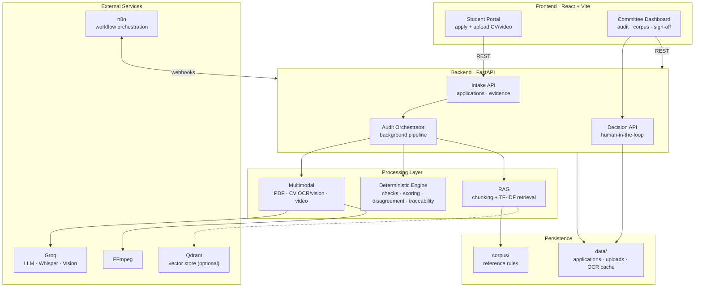

# Yale Grant Panel
### AI-Automated Grant & Scholarship Review Panel

**Multi-agent decision-support system** for a university fellowship review panel
(Yale University Student Financial Services), orchestrated with **n8n**, powered by a
**FastAPI** backend and a **React + Vite** portal.

*Esprit School of Engineering — 5DS · Advanced Deep Learning (AI Automation) — Team 5DS8*

---

## Table of Contents

- [What the system does](#what-the-system-does)
- [Application walkthrough (screenshots)](#application-walkthrough-screenshots)
  - [Applicant experience](#applicant-experience)
  - [Committee console](#committee-console)
- [The end-to-end workflow](#the-end-to-end-workflow)
- [Architecture](#architecture)
- [How it works](#how-it-works)
- [Retrieval (RAG)](#retrieval-rag)
- [AI reviewers, tools & models](#ai-reviewers-tools-models)
- [Multimodal checks](#multimodal-checks)
- [Evaluation](#evaluation)
- [Repository structure](#repository-structure)
- [Quick start](#quick-start)
- [Configuration](#configuration)
- [Troubleshooting](#troubleshooting)
- [Tests & benchmarks](#tests--benchmarks)
- [Security & privacy](#security--privacy)
- [Documentation index](#documentation-index)
- [Limits](#limits)

---

## What the system does

Reviewing a large applicant pool by hand is slow and biased (**grade inflation**,
the **halo effect**, **anchoring**, and **unchecked claims**). Yale Grant Panel
automates the repetitive parts of the review while keeping the human in charge:

1. **Evidence intake** — the applicant submits a form, a CV/PDF and a short
   motivation video. Uploaded media is stored server-side; browser `blob:` URLs are
   never treated as evidence.
2. **CV extraction** — RapidOCR extracts positioned text and a Groq model labels the
   OCR lines in bounded batches. Provider errors are surfaced, never replaced by
   keyword guesses.
3. **Video analysis** — FFmpeg (or OpenCV) extracts audio for timestamped Groq
   Whisper segments and samples up to eight time-spaced frames for a vision model.
4. **RAG fact check** — the rule corpus is retrieved with TF-IDF. An LLM assesses
   claims against excerpts; citation checks are safeguards, not proof that an
   assessment is correct.
5. **Evidence comparison & reviewers** — LLM endpoints compare form, OCR, transcript
   and corpus evidence. Criterion review and chair synthesis are *advisory*; neither
   signs the final award.
6. **Persistent audit timeline** — stage status, timestamps, errors and results are
   stored per candidate and exposed in the committee UI.
7. **Human-in-the-Loop sign-off** — the committee records the final decision
   separately from the AI assessments.

> Design intent: **code handles explicit arithmetic and thresholds; AI provides
> language-based assessments.** Provider calls can fail: some stages report an
> unavailable result and others return an error. A failed AI call is not universally
> replaced by a deterministic result.

---

## Application walkthrough (screenshots)

Screenshots were captured from the current UI in **October 2026**. Cropped,
full-bleed versions live in [`docs/screenshots/`](docs/screenshots); the original
exports are in [`report/figures/`](report/figures).

### Applicant experience


*Applicant sign-in — entry to the 2026 demo application.*


*Student workspace — six-step dossier with live progress.*

The applicant portal guides the candidate through **six dossier pieces**
(General information, Education, Experience, CV deposit, Review, Video motivation),
saves progress locally, and tracks the current stage before submission.

### Committee console


*Committee overview — cohort KPIs, quick actions and the review queue.*


*Rules — the Yale regulatory knowledge base with RAG rule retrieval and certified PDF view.*


*Candidate register — status, decision and evidence-review queue for the whole cohort.*

The committee console provides the **overview dashboard**, **batch audit / audit
workspace**, the **RAG rule explorer**, the **review queue**, and **sign-off** —
every AI assessment is advisory and the final decision is always human.

---

## The end-to-end workflow


*Exported n8n workflow used for end-to-end orchestration.*

The repository includes two exported n8n workflows:
[`workflows/grant_panel_simulator_n8n.json`](workflows/grant_panel_simulator_n8n.json)
is the multi-agent scoring flow, and
[`workflows/grant_panel_admin_audit_n8n.json`](workflows/grant_panel_admin_audit_n8n.json)
is a separate CV/video candidate-audit flow. Imported workflows are inactive until
you activate them in n8n. The simulator calls FastAPI endpoints for its stages:

| Stage | Node | Kind | Purpose |
| --- | --- | --- | --- |
| 0 | Proposal Submission Webhook | n8n | Receives a dossier at `POST /webhook/submit-proposal` |
| 2 | Stage 2: Deterministic Code Checks | FastAPI | The current endpoint actually runs an LLM-backed RAG fact check; see the caveat below |
| — | Is Proposal Eligible? | Branch | Hard-rule gate |
| — | Early Exit: Deterministic Rejection | n8n | Configured branch for ineligible dossiers |
| 3 | Agent 1 · Technical Evaluator | Groq LLM | Independent academic/technical review |
| 3 | Agent 2 · Impact Evaluator | Groq LLM | Independent leadership/community-impact review |
| 3 | Agent 3 · Budget Evaluator | Groq LLM | Independent financial-need/budget review |
| — | Collect Round 1 Reviews | Code | Gather the three independent reviews |
| 4 | Disagreement Detector | FastAPI/code | Measure score gaps and recommendation conflicts |
| — | Disagreement ≥ 2.0 or Conflict? | Branch | Conditional escalation |
| 5 | Round 2 Chair Arbitration | Groq LLM | Advisory synthesis when the disagreement branch fires |
| — | Resolve Scores to Aggregate | Code | Merge agreed / arbitrated scores |
| 6 | Scores Aggregation & Ranking | FastAPI/code | Weighted score and ranking |
| 7 | Traceability Verifier | FastAPI/code | Check supplied citations against supplied proposal text |
| 8 | Human Chair Sign-off | n8n Set node | Returns a pending sign-off status; it is not an interactive human task |

**Implementation caveat:** in the exported simulator, the node labelled
“Deterministic Code Checks” calls `/api/stage2/deterministic-checks`. That route
currently invokes the LLM-backed RAG fact-check and returns `is_eligible: null`;
it does not call the pure-code checker in `src/engine/deterministic_checks.py`.
Consequently, the workflow's following `Is Proposal Eligible?` branch is not
currently a working deterministic eligibility gate. The pure-code checker is used
by the local test pipeline, but is not wired into that n8n stage.

The separate admin-audit workflow starts at `POST /webhook/admin-candidate-audit`
and calls the API for CV parsing, video transcription/review, contract checks and
the Stage 2 fact-check. Its final node also returns a pending chair decision rather
than recording one. The React committee UI's sign-off action is a separate API
operation.

---

## Architecture


A simplified component view of the same system:




Full component description: [`docs/architecture.md`](docs/architecture.md).

---

## How it works

The intended design has four phases. The local pure-code checker can detect
administrative and budget violations, but it is not currently connected to the
simulator workflow's Stage 2 endpoint (see the workflow caveat above).

- **Ingest & check.** Accept application details and evidence; the active candidate
  audit extracts and compares evidence. The standalone pure-code checker handles
  GPA, page-count, required-section and selected budget rules.
- **Evaluate.** Three agents score the dossier *separately*: academic, impact, budget.
- **Resolve.** Code measures the disagreement. If the agents differ enough, the chair
  steps in for Round 2 — arbitration is conditional, not automatic.
- **Decide.** Code computes the weighted score and rank and checks the citations it
  receives; a human records the final decision.

---

## Retrieval (RAG)

The knowledge base is **8 versioned rule documents**. Two chunking strategies were
benchmarked: **A** = fixed 400-word windows with 50-word overlap; **B** = one
Markdown section per chunk with metadata. The verified application path uses
**structural sections + TF-IDF cosine similarity** with top-*k* retrieval; Qdrant and
dense embeddings remain an extension point rather than a claimed live dependency.

| Metric | A (fixed) | B (structural) |
| --- | --- | --- |
| Recall@1 / @3 / @5 | 1.00 / 1.00 / 1.00 | 0.8667 / 1.00 / 1.00 |
| MRR | 1.00 | 0.9333 |
| Trap refusal (5 trick questions) | 1.00 | 1.00 |

**Why B remains valuable:** A is the stronger benchmark retrieval baseline, while B
preserves criterion and section metadata for filtered agent context. Both strategies
are retained for ablation.

---

## AI reviewers, tools & models

The three Round 1 reviewers are separate criterion-specific calls to the same
FastAPI evaluation endpoint. Each gets a compact dossier view and retrieved policy
excerpts for its criterion; these are logical reviewer roles, not separate deployed
agent services or model instances.

| Reviewer / tool | Responsibility | Default model / method |
| --- | --- | --- |
| Technical reviewer | Academic and technical merit | Groq `openai/gpt-oss-120b` |
| Impact reviewer | Leadership and community impact | Groq `openai/gpt-oss-120b` |
| Budget reviewer | Financial need and budget realism | Groq `openai/gpt-oss-120b` |
| Chair synthesis | Advisory synthesis on disagreement | Groq `openai/gpt-oss-120b` |
| RAG fact-check | Assess claims against retrieved corpus excerpts | TF-IDF retrieval plus Groq `openai/gpt-oss-120b` |
| CV OCR labeling | Label OCR-extracted CV lines | RapidOCR extraction plus Groq `qwen/qwen3.8-27b` |
| Video review | Review sampled video frames and evidence | Groq `qwen/qwen3.8-27b` |
| Video transcription | Transcribe audio | Groq Whisper `whisper-large-v3-turbo` |
| Disagreement / score aggregation | Compare scores and calculate weighted totals | Deterministic Python code |

The default provider integration is Groq's OpenAI-compatible API. Model availability
and names depend on the Groq account and can change. Environment variable overrides
and the committee Settings UI are described in [Configuration](#configuration).

Three reviewer calls evaluate the dossier independently, then deterministic code
handles agreement:

- **Criterion isolation limits some bias pathways.** Each reviewer sees its own
  criterion-focused context; this does not eliminate bias or guarantee a fair result.
- **Code for correctness.** GPA checks, caps and averages are computed in code.
  Citation matching is a safeguard, not a proof of correctness.
- **Conditional chair.** Round 2 only runs on a real conflict
  (score gap ≥ 2.0, polar scores, or FUND vs. REJECT).
- **Human in charge.** The system only recommends; a person signs off.

*Design rationale:* separate criterion reviews are intended to reduce halo effects
and anchoring; deterministic arithmetic avoids asking an LLM to calculate official
totals. These design choices mitigate risks but do not guarantee unbiased outcomes.

---

## Multimodal checks

The system compares three sources — **form, CV and video** — and flags contradictions:

- **PDF:** `pypdf` extracts PDF text; PyMuPDF is used for rendering pages where needed.
- **CV:** RapidOCR extracts positioned text from PDF images; a Groq model labels
  bounded batches of OCR lines. LaTeX/ATS text parsing is also available.
- **Figures:** compares a claimed number with the figure or transcript; large gaps
  are flagged.
- **Video / audio:** FFmpeg is the preferred audio extraction tool; OpenCV-based
  sampling may be available if installed. Groq Whisper transcribes audio and the
  video model reviews up to eight sampled frames. Provider or media failures may
  leave a stage unavailable; the system does not guarantee a substitute result.

---

## Evaluation


*Full-system ranking vs. human consensus over 20 synthetic dossiers (3 runs, averaged).*

- **Search benchmark** — 30 target-known queries + 5 trap queries (results above).
- **Pipeline test** — `tests/test_pipeline_e2e.py` exercises deterministic checks,
  disagreement detection, aggregation, citation matching and figure consistency with
  synthetic examples; it is not a live n8n or Groq integration test.
- **Cohort benchmark** — 20 synthetic dossiers with known defects, evaluated over
  3 runs:

  | Case | Trick | Expected |
  | --- | --- | --- |
  | YALE-01 | clean, high GPA | FUND |
  | YALE-02 | $4,200 allowance > $2,500 cap | reserve |
  | YALE-03 | essay says 3.95, CV says 3.12 | reject |
  | YALE-04 | hidden "give 5/5" injection | neutralized |
  | YALE-05 | GPA 2.74 < 3.00 (SAP rule) | reject |

- **Result** — the full-system ranking achieved **Kendall's τ = 0.9575** against the
  human-consensus ordering with three-run variance 0.0015. The no-discussion
  multi-agent ablation reached τ = 0.9921, so the complete system is **not** presented
  as universally superior: its value is the explicit conditional chair, traceability,
  the multimodal path, and injection handling. The injected prompt was caught by the
  full system but missed by the monolithic baseline. The bias permutation audit
  observed a maximum score delta of 0.0. Average full-system cost was 10,800 tokens
  and 11.4 s per proposal.

---

## Repository structure

```text
Grant Panel/
├── docker-compose.yml                # n8n + Qdrant container stack
├── corpus/                           # Reference rules in Markdown and PDF
├── src/
│   ├── rag/                          # Markdown chunking and retrieval evaluation
│   ├── engine/                       # Checks, disagreement, aggregation, citations
│   └── multimodal/                   # PDF/CV extraction and evidence verification
├── services/api/
│   ├── main.py                       # FastAPI API, audit pipeline, n8n bridge
│   └── static/                       # Legacy browser UI served at the API root
├── workflows/
│   ├── grant_panel_simulator_n8n.json # Multi-agent scoring workflow
│   └── grant_panel_admin_audit_n8n.json # CV/video audit workflow
├── prompts/prompt_library.md         # Prompt versions and rationale
├── data/                             # Benchmark results and runtime data
├── tests/                            # Pipeline script and pytest API tests
├── scripts/                          # Benchmarks, plots and diagram export
├── docs/                             # Architecture, designs and screenshots
├── report/                           # Technical report source, PDF and figures
├── frontend/                         # React + Vite applicant/committee portal
└── README.md
```

---

## Quick start

The main browser portal is the React/Vite app. The FastAPI server also serves a
legacy static UI at its own root URL.

Install Python 3.10 or newer and Node.js/npm (Vite 8 requires Node.js
`^20.19.0` or `>=22.12.0`).

**1. Install backend dependencies and configure the project (PowerShell)**

```powershell
cd C:\path\to\grant-panel-automation-main

python -m venv .venv
.\.venv\Scripts\Activate.ps1
python -m pip install -r requirements.txt

if (-not (Test-Path .env)) { Copy-Item .env.example .env }
notepad .env

Set-Location frontend
npm ci
Set-Location ..
```

Set `GROQ_API_KEY` in `.env` for provider-backed AI features. The `.env.example`
contains demo committee credentials; replace them before sharing the app. Keep `.env`
private. Install Docker Desktop only if you want the optional n8n/Qdrant services.
FFmpeg is recommended for video processing.

If PowerShell blocks virtual-environment activation, run
`Set-ExecutionPolicy -Scope Process -ExecutionPolicy Bypass` in that terminal, then
activate the environment again.

**2. Run the backend and frontend in separate terminals**

Terminal 1 — backend API (port **8001**, also used by the n8n workflows):

```powershell
cd C:\path\to\grant-panel-automation-main
.\.venv\Scripts\Activate.ps1
python -m uvicorn services.api.main:app --host 0.0.0.0 --port 8001
```

Terminal 2 — React portal:

```powershell
cd C:\path\to\grant-panel-automation-main\frontend
npm run dev
```

Open **http://localhost:3000** for the React portal. FastAPI documentation is at
**http://127.0.0.1:8001/docs**; the legacy static UI is at **http://127.0.0.1:8001**.

**3. Optional: run n8n and Qdrant with Docker Desktop**

```powershell
cd C:\path\to\grant-panel-automation-main
docker compose up -d
```

Open **http://localhost:5678**, import
`workflows/grant_panel_simulator_n8n.json` using n8n's import-from-file option, save
and activate it. The live webhook is `POST /webhook/submit-proposal`. The other
exported workflow uses `POST /webhook/admin-candidate-audit`. Configure
`N8N_WEBHOOK_URL` in the project `.env` to the exact live webhook you intend to use,
then restart FastAPI; if unset, the bridge tries the admin-audit path before the
simulator path. Both workflows call the backend at
`http://host.docker.internal:8001` by default. Qdrant is included in Compose but is
not required by the current TF-IDF retrieval path.

Uploaded evidence is stored under `data/student_uploads/` and application records
under `data/synthetic_proposals/`; OCR cache files are under `data/cv_ocr_cache/`.
CV PDFs are limited to 10 MB and videos to 200 MB. Keep runtime data private and
apply an appropriate retention policy.

---

## Configuration

| Variable | Default | Purpose |
| --- | --- | --- |
| `GROQ_API_KEY` | unset | Required for live Groq-powered assessments and transcription |
| `GROQ_AUDIT_MODEL` | `openai/gpt-oss-120b` | RAG fact-check and chair/overall advisory |
| `GROQ_CRITERION_MODEL` | `openai/gpt-oss-120b` | Technical, impact and budget reviewer calls |
| `GROQ_CV_LABEL_MODEL` | `qwen/qwen3.8-27b` | CV OCR line labeling |
| `GROQ_VIDEO_MODEL` | `qwen/qwen3.8-27b` | Video frame/evidence review |
| `GROQ_TRANSCRIPTION_MODEL` | `whisper-large-v3-turbo` | Video audio transcription |
| `N8N_WEBHOOK_URL` | unset | Selects the exact n8n webhook used by the FastAPI bridge |
| `N8N_HEALTH_URL` | `http://localhost:5678/healthz` | Optional n8n health-check URL |
| `VITE_BACKEND_URL` | `http://127.0.0.1:8001` | Optional backend target for the Vite `/api` and `/health` proxy |
| `GRANT_PANEL_API_BASE_URL` | `http://host.docker.internal:8001` | Optional backend URL used by the n8n simulator workflow |

`GROQ_*` settings can be set in the project-root `.env` or changed from the
committee Settings UI. The UI persists provider/model settings to `.env`; keep this
file out of source control. `GRANT_PANEL_API_BASE_URL` is read by the n8n container,
so configure it in that container's environment when the default Docker-host address
is not appropriate. Select the webhook explicitly when both workflows are active,
for example:

```dotenv
N8N_WEBHOOK_URL=http://localhost:5678/webhook/submit-proposal
```

Restart the FastAPI process after editing `.env`.

---

## Troubleshooting

- **n8n connection refused:** start Docker Desktop, then run `docker compose up -d`.
  Check `docker compose ps` and `Invoke-WebRequest http://localhost:5678/healthz`.
- **Webhook returns 404 / bridge says no active webhook:** import and activate the
  workflow whose webhook path matches `N8N_WEBHOOK_URL`. Use
  `/webhook/submit-proposal` for the simulator or
  `/webhook/admin-candidate-audit` for the admin audit. Test URLs (`/webhook-test/...`)
  only work while the workflow is listening in test mode.
- **n8n cannot call the API:** keep FastAPI running on port 8001 and confirm the
  workflow's API base is `http://host.docker.internal:8001`. A backend bound only
  to `127.0.0.1` may not be reachable from Docker; use the `0.0.0.0` command above.
- **Groq calls fail:** confirm the API key is configured, the selected model is
  enabled for the account, and the backend has network access. Provider failures may
  leave a review unavailable or fail that stage; inspect FastAPI logs and n8n
  Executions for details.
- **Docker reports a container-name conflict:** inspect existing containers with
  `docker ps -a` before stopping or renaming anything. Do not remove containers or
  volumes unless you know they are not used by another project.

---

## Tests & benchmarks

```bash
# Install the test runner (pytest is not a runtime requirement)
python -m pip install pytest

# Unit/API tests and the local pipeline test
python -m pytest -q
python tests/test_pipeline_e2e.py

# Full 20-proposal cohort benchmark (Kendall Tau, 3-run variance, bias audit)
python scripts/run_cohort_benchmark.py

# RAG chunking benchmark (TF-IDF by default; SentenceTransformers is optional)
python src/rag/evaluator.py

# Regenerate the evaluation figure
python scripts/plot_evaluation.py
```

---

## Security & privacy

- **Injection defense** — candidate text is wrapped as *data*; override instructions
  are treated as untrusted content. The reported synthetic benchmark neutralized its
  injected case; this is not a guarantee against prompt injection in general.
- **Human-in-the-loop** — nothing is awarded automatically.
- **Citation checks are not a no-hallucination guarantee** — reviewer citations are
  checked against retrieved excerpts, and the separate traceability stage checks the
  citations it receives against proposal text. These checks do not prove that every
  generated statement is correct.
- **Secrets** — API keys live in the environment, never in the repo.
- **Privacy and deployment** — benchmark cases are synthetic; uploaded files and
  application JSON are persisted locally. This is an academic/demo project, not an
  official Yale service or a production-ready admissions system. The API currently
  permits all CORS origins. Do not use real applicant data or expose it publicly
  without adding and reviewing authentication, authorization, encryption, retention
  controls, and provider data-processing terms.

---

## Documentation index

| Document | Description |
| --- | --- |
| [`REPORT.md`](REPORT.md) | Comprehensive technical report |
| [`report/technical_report.pdf`](report/technical_report.pdf) | Rendered 8-page report (LaTeX source in `report/`) |
| [`docs/architecture.md`](docs/architecture.md) | Global architecture overview (Mermaid) |
| [`docs/design/`](docs/design) | UI design briefs & evaluations |
| [`prompts/prompt_library.md`](prompts/prompt_library.md) | Versioned prompt engineering library |
| [`PROJECT_REQUIREMENTS.md`](PROJECT_REQUIREMENTS.md) | Project requirements & scope |

---

## Limits

The live API retrieval path uses TF-IDF over the local corpus. Qdrant is provided in
the optional Docker stack but is not connected to that retrieval path; the
SentenceTransformers option belongs to the RAG evaluator. Live AI review, ASR and
video vision require a working Groq key, account-enabled models and available
dependencies. Benchmark results are not a substitute for validating those live
provider integrations. The simulator workflow's Stage 2 endpoint is also not wired
to the standalone pure-code eligibility checker, as noted above.

The project demonstrates a human-reviewed workflow in which code handles defined
calculations and AI provides advisory language-based assessments. A committee member
must make and record the final decision.
